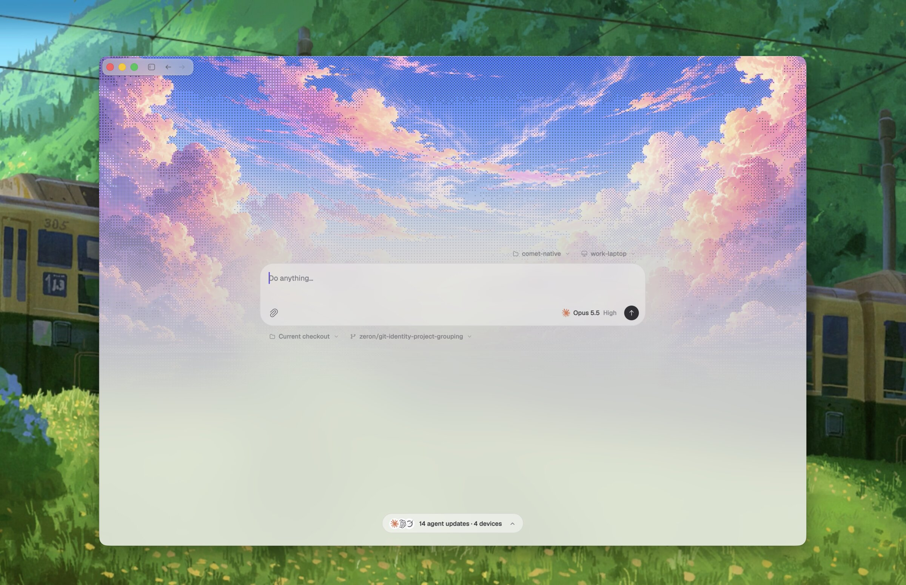

# Zeron

Pilotez vos agents de code (Claude Code, Codex, Cursor, Devin, Grok, Hermes, Pi, Antigravity) en local par défaut, avec une synchronisation facultative entre plusieurs appareils.

*[English](README.md) | [简体中文](README.zh-CN.md) | [한국어](README.ko.md) | [日本語](README.ja.md) | [Español](README.es.md) | Français*



## Application de bureau

Téléchargez la dernière version pour votre plateforme depuis [GitHub Releases](https://github.com/zeronsh/zeron/releases/latest) :

- **macOS** — `zeron-<version>-macos-arm64.dmg`
- **Windows** — `zeron-<version>-windows-x86_64-setup.exe`
- **Linux** — `zeron-<version>-linux-<arch>.tar.gz`, puis lancez le script `install.sh` de l’archive

Aucun compte ni aucune connexion réseau n’est nécessaire ; les sessions restent sur votre appareil. L’application se met à jour automatiquement.

## Mode headless (CLI)

Pour les serveurs et les autres machines sans écran, comme un VPS qui garde vos agents actifs une fois votre portable fermé. Linux uniquement :

```bash
curl -fsSL https://zeron.sh/install.sh | sh
zeron status
```

L’installateur lance le moteur en tant que service d’arrière-plan, relancé à chaque redémarrage.

```bash
zeron status      # mode local/synchronisé et état du moteur
zeron update      # mettre à jour vers la dernière version
zeron daemon start|stop|restart|status
```

## Synchronisation entre appareils (facultative)

Connectez-vous pour lancer un agent sur un appareil, puis le suivre ou le piloter depuis un autre :

```bash
zeron daemon stop
zeron login        # ou zeron logout pour revenir au mode local seul
zeron daemon start
```

Les appareils connectés au même compte peuvent lire et modifier les fichiers de leurs espaces de travail respectifs : ne connectez donc que des appareils de confiance. Les sessions locales existantes ne sont jamais envoyées en ligne.

## Sponsors

Merci à [The Context Company](https://www.thecontextcompany.com/) de sponsoriser Zeron. Vous pouvez vous aussi aider à financer le développement de Zeron en [devenant sponsor sur GitHub](https://github.com/sponsors/zeronsh).

---

Envie de contribuer, ou simplement de savoir comment ça marche ? [Demandez à DeepWiki](https://deepwiki.com/zeronsh/zeron) ou consultez [ARCHITECTURE.md](ARCHITECTURE.md).

Publié sous [licence MIT](LICENSE).
