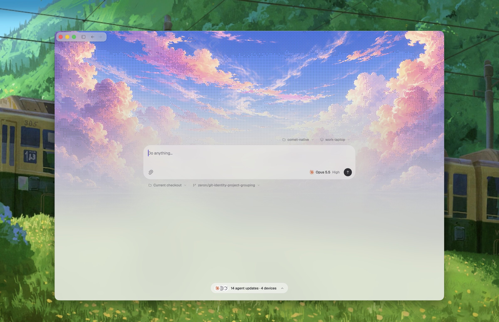

# Zeron

コーディングエージェント（Claude Code、Codex、Cursor、OpenCode、Devin、Grok、Hermes、Pi、Antigravity、Muse Code、fx）をデフォルトではローカルで管理し、必要に応じて複数デバイス間で同期することもできます。

*[English](README.md) | [简体中文](README.zh-CN.md) | [한국어](README.ko.md) | 日本語 | [Español](README.es.md) | [Français](README.fr.md)*



## デスクトップアプリ

[GitHub Releases](https://github.com/zeronsh/zeron/releases/latest) から、お使いのプラットフォーム向けの最新版をダウンロードしてください。

- **macOS**（Apple Silicon、macOS 13 以降）— `zeron-<version>-macos-arm64.dmg`
- **Windows** — `zeron-<version>-windows-x86_64-setup.exe`
- **Linux** — `zeron-<version>-linux-<arch>.tar.gz` を展開し、中の `install.sh` を実行

アカウントもネットワーク接続も不要で、セッションはお使いのデバイスに保存されます。デスクトップアプリは [zgx](https://zgx.zeron.sh)（プラグイン・テンプレート・テーマに対応したネイティブ Rust ＋ ホットリロード対応 Luau UI）で構築されており、自動でアップデートされます。

## ヘッドレス実行（CLI）

サーバーなど、ディスプレイのないマシン向けです。たとえば、ノートパソコンを閉じたあともエージェントを動かし続ける VPS に使えます。Linux のみ対応しています。

```bash
curl -fsSL https://zeron.sh/install.sh | sh
zeron status
```

インストーラーはエンジンをバックグラウンドサービスとして起動し、再起動後も自動的に立ち上がります。

```bash
zeron status      # ローカル/同期モードとエンジンの状態を確認
zeron update      # 最新版にアップデート
zeron daemon start|stop|restart|status
```

## 複数デバイス間の同期（任意）

サインインすると、あるデバイスで起動したエージェントを別のデバイスから確認したり操作したりできます。

```bash
zeron daemon stop
zeron login        # ローカル専用モードに戻すには zeron logout
zeron daemon start
```

同じアカウントにサインインしたデバイスは、互いのワークスペースのファイルを読み書きできます。信頼できるデバイスでのみサインインしてください。既存のローカルセッションがアップロードされることはありません。

## スポンサー

Zeron をスポンサーしてくださっている [The Context Company](https://www.thecontextcompany.com/) に感謝します。[GitHub でスポンサーになって](https://github.com/sponsors/zeronsh) Zeron の開発を支援することもできます。

---

開発に参加したい方や仕組みが気になる方は、[Ask DeepWiki](https://deepwiki.com/zeronsh/zeron)、[ARCHITECTURE.md](ARCHITECTURE.md)、[CONTRIBUTORS.md](CONTRIBUTORS.md)、[apps/zgx/README.md](apps/zgx/README.md) をご覧ください。

[MIT License](LICENSE) のもとで公開されています。
